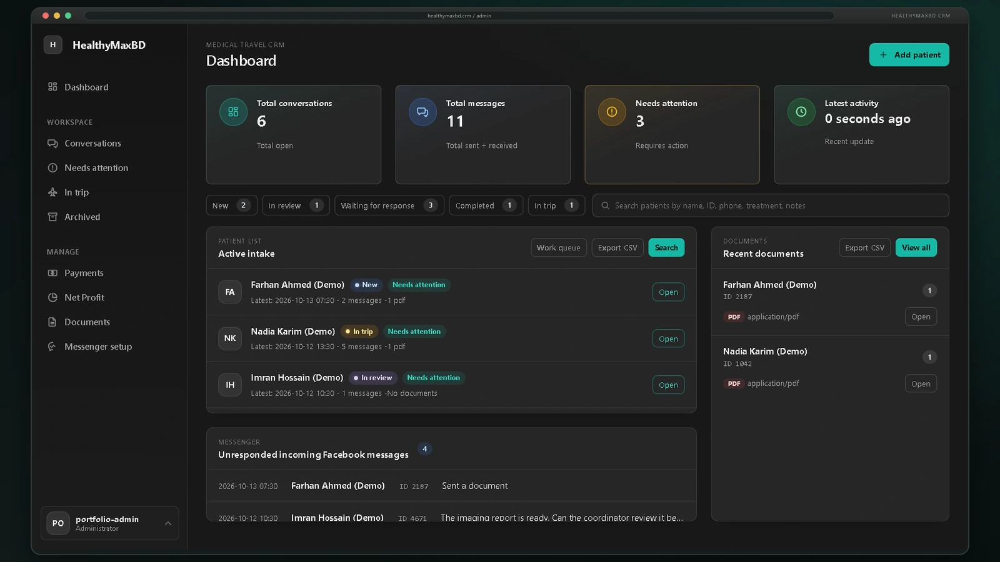
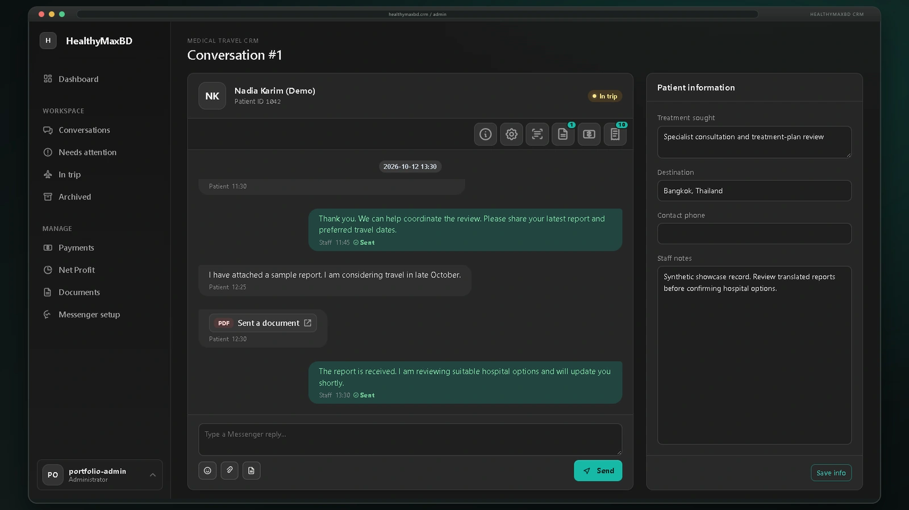
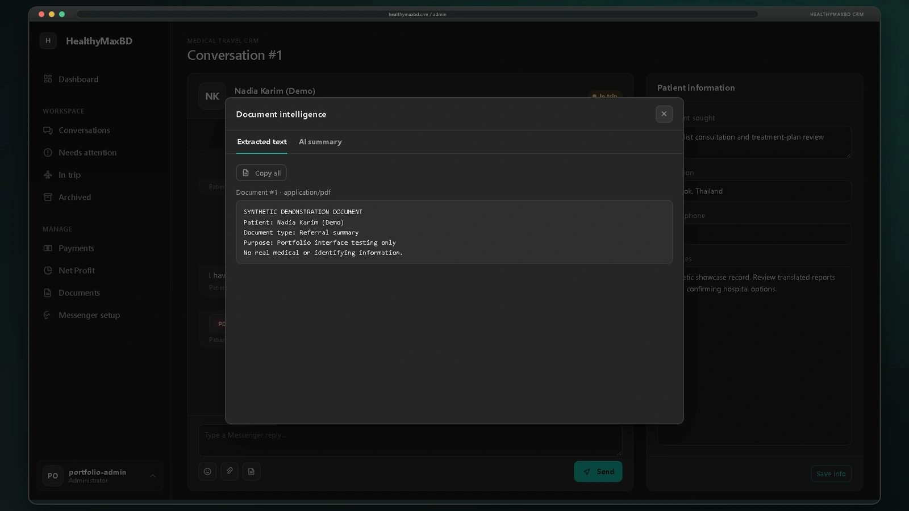
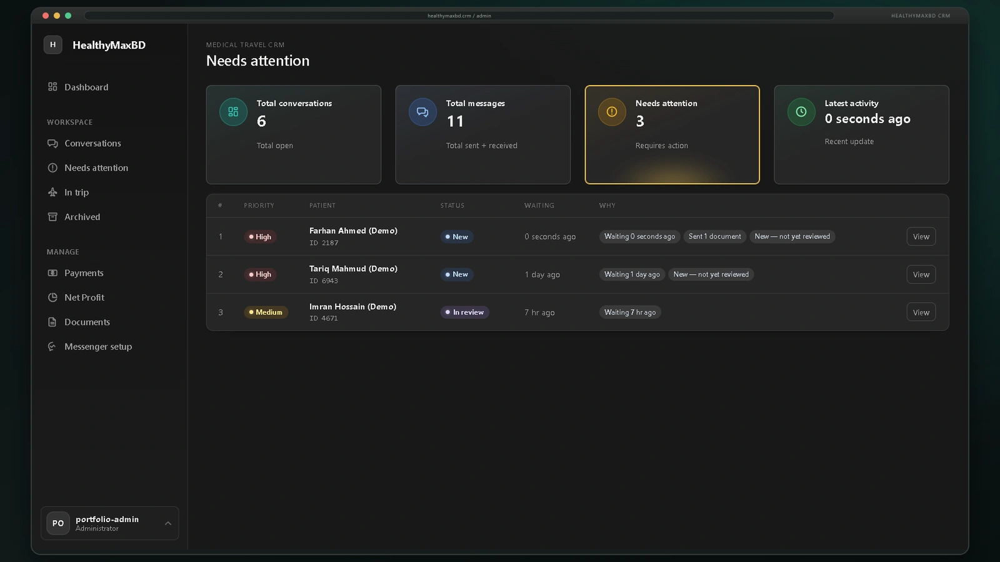

# HealthyMaxBD CRM

### A medical-travel operations workspace for patient intake, coordination, trip history, and staff reporting.

  
  
  
  
  

<em>Built around the operating model of a Bangladesh-to-Thailand healthcare coordination service.</em>

## Project overview

HealthyMaxBD CRM brings the day-to-day work behind a medical-travel service into one authenticated administration workspace. Enquiries arrive through Facebook Messenger or staff entry, then move through review, treatment coordination, document handling, trip tracking, follow-up, and internal reporting.

The private application is implemented software, not a static interface concept. It combines persistent business records, an integrated messaging workflow, patient-linked document review, trip history, staff reporting, and operational safety controls. This public repository contains the case study and synthetic screenshots only.

## Product capabilities

| Area | Verified capability |
|---|---|
| **Patient intake and triage** | Searchable dashboard, manual record creation, lifecycle states, derived in-trip and waiting-for-reply signals, ranked attention queue, internal notes, filtering, sorting, and CSV export. |
| **Conversation workspace** | Messenger-backed threads, staff replies with delivery states, message polling, profile enrichment, announcement drafts, pagination, and patient-specific treatment context. |
| **Document coordination** | Conversation-linked uploads, authenticated file delivery, OCR status and extracted-text review, document notes, and guarded model-assisted analysis. |
| **Trip coordination** | Multiple trips per patient, open/closed state, visit records, and trip-aware patient workflow signals. |
| **Staff reporting** | Internal reporting views and patient/trip drill-downs to support day-to-day coordination. |

## Patient coordination keeps its context

The conversation workspace keeps messages beside treatment goals, destination, contact details, staff notes, case status, documents, and trip controls. Incoming activity can reactivate an archived case. Operational signals such as **In trip** are derived from trip records rather than duplicated as manually maintained labels.

The conversation list adds instant filters, response-state detection, priority explanations, sorting, pagination, and live activity polling. Staff can prepare replies while delivery remains behind explicit controls.

Each trip remains a distinct episode in the patient's history, with open/closed state and related coordination records. Trip-aware signals surface current work in the dashboard and patient workspace, so staff can see the operational context without maintaining duplicate status fields.

## AI-assisted document scanning and review

The CRM links uploaded documents to their conversations and supports OCR text extraction, AI-assisted scanning, review states, and staff notes. Processing is gated for real patient material; the screenshots use fictional records and explicitly synthetic document content.

The public case study describes this workflow without exposing provider credentials, configuration, internal APIs, or private implementation details.

## A ranked queue makes follow-up visible

The attention view ranks work using signals such as waiting time, case status, and outstanding review. It gives coordinators a practical next-action queue while preserving the underlying patient lifecycle state.

## Verified technology

- **Python 3 and Flask 3** for the application, webhooks, administration routes, exports, and background workers.
- **Jinja, CSS, and vanilla JavaScript** for the self-hosted administration interface, filters, modals, charts, and interaction states.
- **SQLAlchemy 2 with SQLite and PostgreSQL support** for relational persistence and database portability.
- **Flask-Login and Werkzeug security** for authenticated administration, password hashing, CSRF validation, and secure production configuration.
- **Meta Graph API and Cloudinary** for Messenger workflows and authenticated document storage/delivery.
- **OCR and AI-assisted document scanning** behind configuration and privacy controls; plus Pillow, Requests, Gunicorn, CSV, and local backup tooling.

## Engineering highlights

### 1. Patient workflows connected across trips

Trip history, conversation activity, documents, and follow-up state stay connected to the patient record, helping staff retain context across care-coordination episodes.

### 2. Operational signals derived from records

The application separates stored lifecycle status from activity derived from messages, documents, replies, and open trips. This supports triage and queue filtering without spreading conflicting copies of the same state.

### 3. Safety before automation

Messenger webhook signatures are checked and duplicate deliveries are guarded. AI reply drafting and sending use separate feature gates, manual replies are draft-first, and live announcement delivery remains unimplemented. Document analysis for real patient content also requires explicit privacy configuration.

## My contributions

I designed and implemented the application end to end, including the product model, Flask backend, relational data layer, administration interface, Messenger and document workflows, trip coordination, safety controls, regression tests, and local operations tooling. The inspected private repository contains 15 commits attributed to my GitHub identity, spanning the initial scaffold through the current CRM and document-review workflows.

## Project context

HealthyMaxBD CRM is a tested **pre-production private application**. Local workflows and automated tests provide implementation evidence; this case study does not claim production scale, measured business outcomes, or live use with patients. External integrations require deployment credentials. AI sending is disabled by default, the AI intake persona remains a placeholder, announcement delivery is draft-only, high-volume attachment processing is future work, and narrow-screen layout refinement is still required.

Every visible person, message, identifier, and document in this gallery is synthetic. Financial and transaction screens are intentionally omitted from the public showcase. No patient records, credentials, private source, internal API specification, database schema, or reproduction instructions are included.

---

  <strong>Hasan Al Maher</strong> 
  Software Engineer · AI Implementation Specialist 
  <a href="https://github.com/poralekhamaher">GitHub</a> · <a href="https://www.hasanalmaher.com/">hasanalmaher.com</a>

